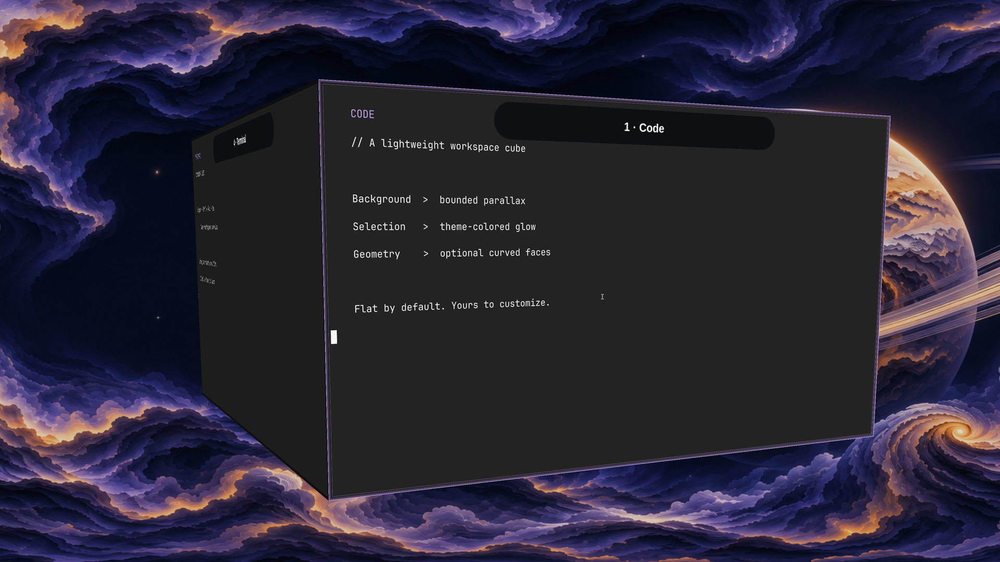
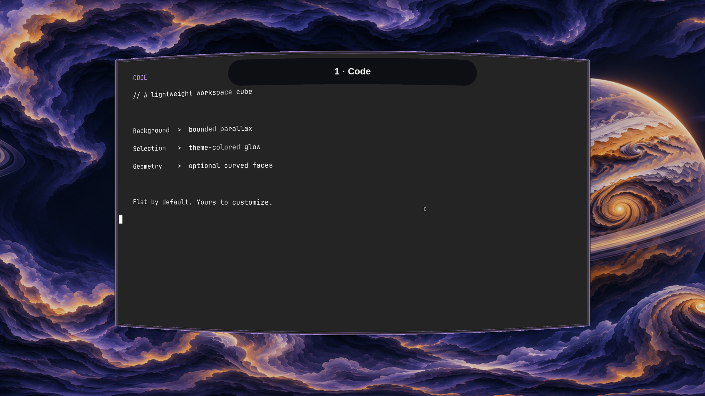
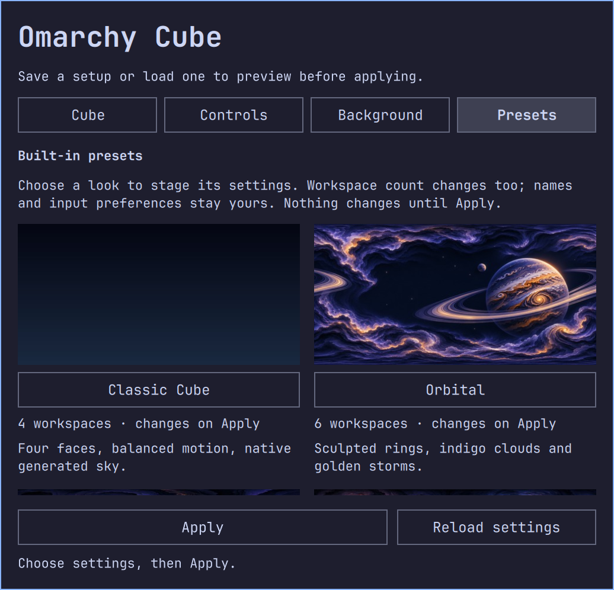

# Omarchy Cube

Native workspace cube/prism for Omarchy, with parallax backgrounds, theme-colored
edge glow, built-in looks, and optional curved faces. Includes a tabbed settings panel
and guided first-run native setup. **Ten workspaces by default.** Four faces give the classic cube;
5–20 form a rotating prism with one face per workspace. Zoom-out automatically
scales with the shape so the extra faces stay in view.

Experimental, built for Hyprland **0.56.2**, commit
`efb50993780079460b0cbed1363e2166a2de1d9f`. Other builds are rejected before hooks
are installed. This is a compositor plugin; the optional settings widget uses
Omarchy's shell.

## In action



Actual native rendering with generated demo terminal content, not a mockup or a
capture of personal windows. The background is supplied generated artwork.

<details>
<summary>Experimental curved faces and the tabbed preset panel</summary>





</details>

Screenshots are real captures. Native scenes are rendered at 4K in a disposable
headless compositor, cropped slightly to omit its startup warning, and delivered
at 1920×1080. The panel image is cropped tightly to omit unrelated windows. See
[preview capture notes](docs/screenshots/README.md).

## Build and test

Requires matching Hyprland headers, C++23, pkg-config, pixman, libdrm, Cairo, pangocairo, Lua
headers, GLESv2 and libjpeg-turbo (used for native JPEG decoding). The shell controls additionally require Omarchy Quattro, Quickshell, Python 3,
Lua CLI (for setup validation) and Zenity (for the image chooser). Tests use Pillow, Foot, Grim and wtype.

```sh
make -j2
make test
python3 tests/settings.py
python3 tests/install-gui.py
python3 tests/setup.py
python3 tests/presets.py
omarchy plugin validate "$PWD"
# In a sandbox using ptrace, disable only LeakSanitizer:
ASAN_OPTIONS=detect_leaks=0 make test
```

Math tests use AddressSanitizer and UndefinedBehaviorSanitizer. Actual rendering
is tested in a disposable nested compositor:

```sh
Hyprland --config "$PWD/tests/nested.lua"
# In another terminal:
python3 tests/integration.py
python3 tests/integration.py --highres --no-capture
python3 tests/gestures.py --display wayland-N --screenshot
python3 tests/window-carry.py --display wayland-N
python3 tests/curvature.py --display wayland-N
```

The test checks the compositor's command line and refuses a personal session. It
requires Foot and Grim. The high-resolution run creates/removes a virtual 4K
output inside the nested session. Captures and timing samples go in `build/`.
Close the nested compositor afterward. Use `--no-capture` for frame-pacing tests:
screenshot readback can itself stall rendering.

## One-command setup from a checkout

On a fresh Omarchy install running the supported Hyprland build, review the
release checkout, then run `./tools/install` from it in a terminal. It adds the
matching marketplace widget, runs guided native setup, and enables the widget
only after the native plugin responds. No config edits or separate build commands
are needed. Native activation still requires confirmation, and missing system
dependencies may prompt for sudo. This is not the marketplace's one-click flow.
If the final widget enable fails after native setup succeeds, retry just
`omarchy plugin enable omarchycube.controls`.

## Marketplace installation

Install and enable the widget normally:

```sh
omarchy plugin add https://github.com/sterlingmchase/omarchy-cube.git --enable
```

Click the cube icon, then **Set up native Cube…**. A terminal explains the changes
and asks for confirmation. Save your work first: this loads native code inside
Hyprland. Setup checks the exact supported compositor commit, installs missing
Arch build dependencies with your approval, builds locally, backs up
`hyprland.lua`, and installs the module and GUI settings bridge. Return to the
widget and click **Refresh** when it finishes. No copy/paste configuration is
required for a fresh, standard Omarchy installation.

Setup refuses unsupported compositor versions and existing native installations
rather than overwriting settings or replacing a running library. Package installs
are not rolled back, but failed activation restores the original configuration.
You can also run `python3 tools/setup` from the checkout, or use `--check` for a
read-only compatibility check. Updates still follow the procedure below.

The marketplace's **Manual setup** classification is external catalog metadata;
it must be reviewed/updated there after this setup flow ships. This repository
cannot clear that marketplace gate by changing its manifest, and Omarchy's current
plugin installer has no native build/install lifecycle hook. The explicit first-run
confirmation is intentional, not silent execution when the widget is imported.

### Advanced/manual installation

The marketplace installs the **settings widget source**, not the native compositor
library. Enabling the widget alone cannot activate the cube. Build locally against
exactly the supported Hyprland commit above; prebuilt binaries are not distributed.
The default install path is `~/.local/lib/hypr/omarchy-cube.so`; custom `PREFIX`
values require adjusting the Lua module and GUI setup script.

1. Add this repository with `omarchy plugin add https://github.com/sterlingmchase/omarchy-cube.git` (without `--enable`).
2. Open `~/.config/omarchy/plugins/omarchycube.controls`, run `make -j2` and
   `make install`, then follow **Install locally** below to load the native plugin.
   Copy the example only if you do not already have `~/.config/hypr/cube.lua`;
   otherwise merge it into your existing module after making a backup.
3. From that checkout, run `tools/install-gui --bridge-only`. This explicitly
   backs up and updates `cube.lua` so Apply can persist settings; it does not
   install a second widget. The script rejects unrelated settings files before
   editing the module and rolls back the module if reload fails. Upgrade the
   native library before rerunning setup to replace the old bridge.
4. Run `omarchy plugin enable omarchycube.controls`.

An existing development installation may use the `local.cube` widget. Disable it
before enabling `omarchycube.controls` to avoid duplicate bar controls. Its native
configuration and saved settings can be reused.

### Updates and removal

`omarchy plugin update omarchycube.controls` updates source and the widget, not
the loaded native library. After reviewing an update, rebuild, temporarily remove
`require("hypr.cube")` from your Hyprland configuration, reload and explicitly unload
`~/.local/lib/hypr/omarchy-cube.so` with `hyprctl plugin unload` before reinstalling
and restoring the require. Check `hyprctl configerrors` after each reload. Back up
the old library and configuration first. Hyprland updates can require a new
compatible cube release; never bypass the version check.

To remove: disable/remove `omarchycube.controls` using `omarchy plugin disable`
and `omarchy plugin remove`; remove the Lua require, reload, unload the native
plugin, then remove `~/.local/lib/hypr/omarchy-cube.so`. Keep `cube.lua`,
`cube-gui.lua` and their backups unless you want to delete your saved settings.
If using the development installer, disable/remove `local.cube` instead.

## Permissions and license

BSD-3-Clause; see [LICENSE](LICENSE). The cube runs inside Hyprland, captures
workspace textures in GPU memory, reads the chosen local image, and handles input
while its overview is open. Optional Shift-drag moves windows only on release.
The widget invokes local `hyprctl` commands and writes its own `cube-gui.lua`
settings with backups; the setup script modifies `cube.lua` only when explicitly
run. No telemetry, network requests or runtime downloads are implemented. No personal
window captures are bundled. Three maintainer-supplied generated illustrations and
four previews are included by request. These images remain at their native
1774×887 resolution and use a lightweight parallax backdrop, not spherical mapping.
The code license does not automatically relicense artwork; see
`shell/assets/skydomes/README.md` for provenance and distribution notes.

## Install locally

Save work before first activation: native compositor plugins can crash the desktop session.

```sh
make install
```

Copy `examples/cube.lua` to `~/.config/hypr/cube.lua`, check the example shortcuts
for conflicts, and add `require("hypr.cube")` after your normal Omarchy configuration
in `hyprland.lua`. Run `hyprctl reload` and `hyprctl configerrors`.

Super+Ctrl+Alt+Left/Right rotate in the installed setup. Repeated presses
retarget from the current position immediately, including reversals. Keybindings call Lua directly without spawning a
process. Manual control:

```sh
hyprctl eval 'local ok, err = hl.plugin.cube.rotate("right"); assert(ok, err)'
hyprctl eval 'hl.plugin.cube.rotate("cancel")'
hyprctl omarchy-cube:status
```

Cancel reveals the already selected destination; it does not undo the switch.
Remove the Lua require and reload before `make uninstall`. Rebuild/install replaces
the library atomically, so an already loaded mapping is never truncated.

## Settings

Edit `plugin.cube` in the example Lua module, or install the graphical controls
**after** loading the native plugin:

```sh
tools/install-gui
```

The installer backs up the Lua module, adds the GUI settings bridge, validates the
reload, then enables the `local.cube` bar widget. Click its cube icon. Previous/Next rotate once, or choose **Mouse controls**:

- **Super + Ctrl + Alt + Up** opens mouse mode.
- **Super + Ctrl + Alt + left-drag** opens mouse mode and rotates immediately; release to select the front workspace with a 220 ms rotation-and-zoom landing.
- Entry eases out over 220 ms while rotation follows the drag immediately.
- Drag vertically to tilt up/down by up to 45° and look through the open ends; shaded inner walls need no extra workspace snapshots. Release-to-select smoothly levels the cube.
- When opened using the keyboard or panel, left-drag to rotate; releasing snaps to the nearest face and leaves mouse mode open.
- Four-finger trackpad swipe opens and rotates the cube; release selects with an animated landing. A swipe inside an already-open overview leaves it open. Escape or a cancelled gesture cancels. Three-finger workspace gestures remain available. Disable cube swipes under Drag controls.
- Optional window moving: enable **Move windows with Shift-drag** under Drag controls. In mouse mode, hold Shift and drag a window inside a face; release to move it to the front workspace and land there. The destination outline and window title show where it will go. Escape/right-click cancels without moving it. Ordinary dragging still rotates. Pinned and grouped windows are excluded; destinations on another monitor are rejected. This option starts off and appearance presets preserve it.
- Scroll to rotate through workspaces.
- Click a face to select it with a smooth rotation-and-zoom landing.
- Right-click or Escape cancels without switching.
- Arrow keys rotate the preview; Enter selects with the same animated landing.

Expand **Workspace names** in the panel to give numbered faces names such as Code or Web. Blank entries use the workspace’s existing name or number. These labels affect the cube only; workspace IDs and window assignments stay the same. The selected face has a subtle outline. Both can be disabled in the
panel. Horizontal and vertical drag sensitivity and inversion are independent.
Optional momentum lets a quick release advance at most one extra face; it is off
by default.

Mouse and keyboard events in the overview are consumed so they do not reach the
windows underneath. A stationary overview does not request continuous redraws.
Close the console/special workspace before opening it.

Settings changes apply
only when you press Apply; invalid settings roll back. The helper runs on demand,
with no background polling. GUI values live in `~/.config/hypr/cube-gui.lua` and
override the example's defaults.

| Setting | Default | Range / meaning |
| --- | --- | --- |
| `enabled` | `true` | Disabled: switch instantly |
| `duration_ms` | `280` | 120–600 ms |
| `zoom` | `0.7` | 0–1.5; scales with prism size |
| `workspace_count` | `10` | Numbered workspaces 1–N, N=4–20 |
| `carry_windows` | `false` | Enable Shift-drag window transfers within the cube |
| `trackpad_enabled` | `true` | Enable four-finger cube swipes |
| `workspace_name_1` … `workspace_name_20` | empty | Cube display names, up to 80 characters |
| `show_labels` | `true` | Workspace names or numbers on faces |
| `highlight_selected` | `true` | Theme-colored selected-face edge glow |
| `face_curvature` | `0.0` | Experimental horizontal bow: −1 concave, 0 flat, +1 convex |
| `horizontal_sensitivity` | `1.0` | Horizontal drag multiplier, 0.25–3 |
| `vertical_sensitivity` | `1.0` | Vertical drag multiplier, 0.25–3 |
| `invert_horizontal` | `false` | Reverse horizontal drag |
| `invert_vertical` | `false` | Reverse vertical drag |
| `momentum` | `false` | Quick-release advance, at most one extra face |
| `skydome_enabled` | `true` | Show backdrop |
| `skydome_path` | empty | Absolute PNG or JPEG path; empty uses generated sky |
| `skydome_brightness` | `0.65` | 0.1–1 |
| `skydome_mode` | `photo` | Legacy compatibility key; all values now use the backdrop |

Background images use aspect-correct cover framing with 10% overscan. Bounded
horizontal/vertical parallax follows rotation/tilt in the opposite direction,
without exposing borders. Turning animations off also disables parallax, including
manual tilt. No true spherical mapping, 8K assets or extra texture layers are
required; ordinary detailed images around 2K are suitable. Tall/ultrawide displays
crop rather than stretch. Legacy `auto`, `photo` and `panorama` settings remain
accepted so existing settings and presets still load, but all use this backdrop.

The selected face has a sharp theme-colored edge with a soft inward glow, controlled
by the existing highlight toggle. It uses the existing face shader: no blur pass,
extra framebuffer, extra face capture or pulsing/idle animation. The glow fades
out before the workspace center so text stays readable.

**Experimental face curvature** is opt-in in the Cube tab. Negative values bow
inward, positive values bow outward; zero uses the original flat quad. This is a
gentle horizontal curve, not a sphere. Twenty-four mesh strips reuse each face's
existing texture, with selection/window hit testing against the same strip planes.
The bend fades back to flat while landing, and scales down on prisms with many
faces to avoid wall intersections. Old GUI settings still load; old custom presets
without curvature leave your current curvature unchanged. New custom saves include it.
Upgrade the native library and run `tools/install-gui --bridge-only` to upgrade an
existing data-only GUI bridge before applying the new setting.

Curved faces disable the flat-only background-occlusion shortcut and add an
interior mesh pass, but no additional per-strip workspace captures or image layers.
Flat remains the lightweight default. Assess the opt-in prototype on your hardware;
this is not a promise of sphere rendering or distortion-free text at strong bends.

Images are decoded/uploaded on settings changes, never per frame or per turn.
Replacing the same file and reloading picks up its changed modification time.

Images must be regular files under 32 MiB. PNGs are limited to 8192 pixels
per side and 16 megapixels. JPEG sources may be up to 16384 pixels per side
and 64 megapixels; larger JPEGs use the highest supported decode resolution that keeps
textures within the same 8192-pixel/16-megapixel limits without modifying originals. Invalid images fall back to the generated sky;
the status command reports the error, and the GUI rejects/rolls back a failed image
change. PNG and JPEG are supported image formats.

Open the **Presets** tab for four offline built-ins: **Classic Cube**, **Orbital**,
**Deep Space**, and **Golden Hour**. Each card shows its workspace count and an
scene preview. Selecting one stages its appearance and workspace count;
only **Apply** changes the desktop. Workspace names, enable switches and input
preferences are preserved. Classic clears the image path and uses the native sky.
Built-ins cannot be overwritten or deleted. See [PRESETS.md](PRESETS.md) for details.

Under **My presets**, save a named combination of the pending background, zoom,
animation, labels, sensitivity and inversion settings. Select a saved preset and
Load, then Apply to activate it. Save replaces the same-named custom preset; Delete
removes it. Custom presets retain the existing behavior of preserving workspace
counts, names and enable switches. They store image references, not copies of user
images, in `~/.config/hypr/cube-presets.json`. Bundled images use stable built-in IDs
so custom copies still work if the widget is relocated; external images retain
absolute local paths. No network access or runtime Pillow/NumPy dependency is needed.
Artwork can be reproduced from verified originals with
`python3 tools/generate-skydomes.py --source-dir /path/to/originals` (development
only; requires Pillow). Source filenames and SHA-256 checksums are recorded in
`shell/assets/skydomes/sources.json`; provenance is in the adjacent README.

## Performance and behavior

- A bounded cache captures faces only as they become visible and releases hidden
  faces. This also supports reversing or dragging without caching every workspace. A four-sided
  cube needs two; the default ten-sided prism needs four at default zoom.
- Captures stay on GPU. No CPU pixel readback or screenshot subprocess is used by
  the plugin. Skydome drawing skips a conservative rectangle covered by an opaque face, using at most four scissored strips; visible workspace faces then cover that area. Image resolution and filtering stay unchanged.
- Shaders, uniform locations and vertex data are prepared outside animation frames.
  Face textures are released at the end. No cube rendering or armed timers while idle. A single end deadline also frees
  snapshots when an occluded output stops receiving frames.
- Snapshot storage is approximately `width × height × 4 × captured_faces` bytes:
  about 126.6 MiB at 4K for four faces, excluding driver/compositor buffers. More
  faces/zoom can need additional snapshots. The skydome texture stays cached.
- Animation uses elapsed time and smooth easing, with rendering scheduled through
  Hyprland's damage handling. Disabling global animations skips captures entirely.
- Status reports capture CPU milliseconds, draw submission CPU microseconds,
  average/max frame intervals, and intervals exceeding 1.5 refresh periods. These
  are not measurements of GPU completion or guarantees on other hardware.

Workspace faces use snapshots; an uncached face is captured when it comes into
view. Dragging changes the preview without switching workspaces until you select
a face. Keyboard turns switch immediately and can be interrupted by further turns. The current monitor must be unrotated and
its special workspace closed. Named-only workspace IDs are not supported; numbered workspaces may have display names. A destination
owned by another monitor is rejected; foreign-monitor side faces show only the
local background. Windows move only when the optional Shift-drag control is enabled and a valid drop is released. Empty workspaces are created only when
selected, not merely to preview them.

Resize/rotation, external workspace switches, reload and session lock cancel the
visual transition. Queued custom render passes are removed before unloading.
Native workspace animations finish behind the cube. Updating Hyprland requires
reviewing its private rendering API and rebuilding.

See `VALIDATION.md` for measured results and remaining verification limits.

Mouse regression tests: `python3 tests/mouse.py --display wayland-N --headless`, using the
explicit socket of the isolated fixture. They require Wayland development tools
and Wtype and refuse to target a personal desktop.

Use **Browse…** below the skydome image field to choose a PNG or JPEG with the GNOME file picker (requires `zenity`), then **Apply**. Cancelling preserves the current image and pending settings. Nautilus itself is a file manager, not a selection-returning dialog.


The floating Omarchy dock is omitted from cube snapshots and returns after the transition, preventing stale dock images on empty workspace faces.
